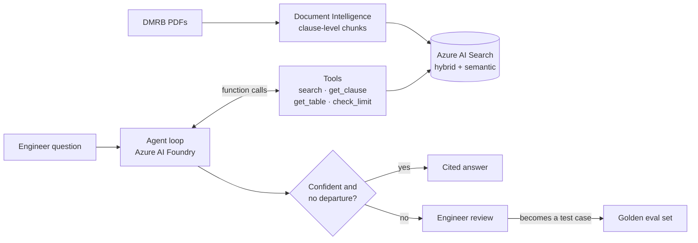

# DMRB Standards Assistant

[](https://github.com/benw312/dmrb-standards-assistant/actions/workflows/ci.yml)


[](LICENSE)

An AI agent that answers UK highway design questions from the
[Design Manual for Roads and Bridges](https://www.standardsforhighways.co.uk/) (DMRB) in plain
English. It cites the exact clause, does numerical checks in code rather than in the model, and
passes uncertain answers to an engineer for review.

> **Status: in development.** Built in public. See [PLAN.md](PLAN.md) for progress and
> [DECISIONS.md](DECISIONS.md) for the reasoning behind each design choice.

## How it works



## Design principles

- **The model never does arithmetic.** It extracts numbers; `check_limit()` compares them in Python.
- **Citations are verified in code.** Every clause ID in an answer must be among the retrieved
  chunks, or the answer is rejected.
- **Clause-level chunking.** One chunk per DMRB clause, with NOTEs and tables kept with their
  parent clause and tagged by requirement strength (shall / should / may).
- **Humans make the call.** Possible Departures from Standard, low confidence, failed citation
  checks and out-of-scope questions are escalated, not answered.
- **Evaluated, not eyeballed.** A hand-written golden question set measures retrieval recall,
  citation precision, departure accuracy and refusal accuracy.

## Progress

| Phase | Scope | Status |
|---|---|---|
| 0. Setup | Repo, CI, Azure resources (keyless auth) | In progress |
| 1. Ingest | PDFs → clause chunks with metadata | Not started |
| 2. Index | Hybrid vector + keyword index, recall@5 | Not started |
| 3. RAG | Cited answers or refusal | Not started |
| 4. Agent | Tool-calling loop with traces | Not started |
| 5. Human review | Confidence gate and escalation | Not started |
| 6. Evaluation | Golden set, metrics, model comparison | Not started |
| 7. Ship | Streamlit demo | Not started |

## Stack

Python 3.12 · uv · Azure AI Foundry (`azure-ai-projects` 2.x) · Azure AI Search ·
Azure AI Document Intelligence · `azure-ai-evaluation` · Pydantic · pytest · GitHub Actions

## Getting started

Prerequisites: [uv](https://docs.astral.sh/uv/), the Azure CLI, and an Azure subscription.

```bash
uv sync
uv run pytest                     # offline tests, no Azure needed

az login                          # all Azure auth is keyless (DefaultAzureCredential + RBAC)
cp .env.example .env              # fill in endpoints and deployment names
```

Azure resources are created with [`scripts/azure_setup.sh`](scripts/azure_setup.sh) and removed
with [`scripts/azure_teardown.sh`](scripts/azure_teardown.sh).

## Project layout

```
ingest/    PDF parsing and clause chunking
index/     Azure AI Search schema and rebuild
agent/     RAG pipeline, agent loop and tools
evals/     Metrics and evaluation runners
app/       Demo UI
scripts/   Azure setup and teardown
data/      sources.yaml (PDFs and parsed text are not committed)
```

## Licence and disclaimer

Code is MIT licensed. The DMRB is Crown copyright and published by National Highways. This repo
links to the source documents and does not redistribute them.

This is a decision-support prototype, not a substitute for a competent engineer. Always confirm
against the current version of the standard.
