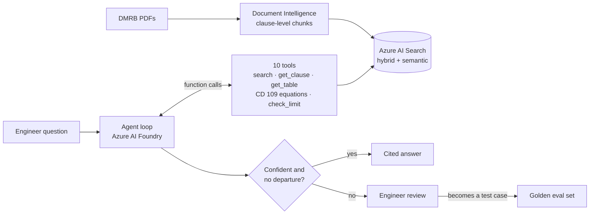

# DMRB Standards Assistant

[](https://github.com/benw312/dmrb-standards-assistant/actions/workflows/ci.yml)


[](LICENSE)

An AI agent that answers UK highway design questions from the
[Design Manual for Roads and Bridges](https://www.standardsforhighways.co.uk/) (DMRB) in plain
English. It cites the exact clause, does numerical checks in code rather than in the model, and
passes uncertain answers to an engineer for review.

> **Status: in development.** Built in public. See [PLAN.md](PLAN.md) for progress and
> [DECISIONS.md](DECISIONS.md) for the reasoning behind each design choice.

## How it works



## Design principles

- **The model never does arithmetic.** It supplies the inputs; equation tools (superelevation,
  transition length, visibility...) and `check_limit()` compute and compare in exact decimals.
- **Citations are verified in code.** Every clause ID in an answer must be among the retrieved
  chunks, or the answer is rejected.
- **Clause-level chunking.** One chunk per DMRB clause with its NOTEs, tagged by requirement
  strength (must / shall / should / may); tables, figures and the glossary are their own chunks.
  A table found by search brings the clause that makes it binding.
- **Humans make the call.** Possible Departures from Standard, low confidence, failed citation
  checks and out-of-scope questions are escalated, not answered.
- **Evaluated, not eyeballed.** Hand-written questions measure retrieval recall; a golden set
  scores citation precision and recall, requirement, departure and refusal accuracy, and
  cost per question for each pipeline (`python -m evals.golden`).

## One agent, two orchestrations

The same tools, prompt, citation gate and limits run two ways, and tests check they behave
identically on the same scripted model:

| | `agent/loop.py` | `agent/graph.py` |
|---|---|---|
| Control flow | A plain loop over the Azure OpenAI Responses API | A LangGraph `StateGraph`: model, tools, check, limit and review nodes |
| Limits | 6 model calls, 90 s, tools off on the last step | Same, as conditional edges |
| Human review | Escalated answers are flagged | Flagged, and the graph can **pause before review** with a checkpointer and resume after an engineer looks |

The loop is the clearest way to see what an agent is; the graph is what you'd extend
(parallel tool branches, persistence, human-in-the-loop). `python -m agent.graph --mermaid`
prints the graph.

## Progress

| Phase | Scope | Status |
|---|---|---|
| 0. Setup | Repo, CI, Azure resources (keyless auth) | Done |
| 1. Ingest | PDFs → clause chunks with metadata | Done: 4 standards, 654 chunks |
| 2. Index | Hybrid vector + keyword index, recall@5 | Done: semantic recall@5 **100%**, MRR 0.83 (20 questions) |
| 3. RAG | Cited answers or refusal | Done: 9/10 on a first hand-judged check ([evals/rag_check.md](evals/rag_check.md)) |
| 4. Agent | Tool-calling loop with traces | Built: 10 tools, 6-step loop, JSONL traces; 9/10 first run ([evals/agent_check.md](evals/agent_check.md)) |
| 5. Human review | Confidence gate and escalation | Not started |
| 6. Evaluation | Golden set, metrics, model comparison | Not started |
| 7. Ship | REST API, Streamlit demo | REST API built (`app/api.py`: `POST /ask`); demo not started |

## Retrieval results

Recall on 20 hand-written engineer questions across CD 109, CD 123 and CG 501
(`uv run python -m evals.recall`). A question counts as a hit if any clause an engineer would
cite appears in the top 5 distinct clauses; coverage is the share of all expected clauses found.

| | keyword | vector | hybrid | semantic |
|---|---|---|---|---|
| **recall@5** | 80% | 90% | 90% | **100%** |
| MRR@5 | 0.64 | 0.80 | 0.70 | 0.83 |
| coverage@5 | 71% | 79% | 82% | 80% |

Semantic (hybrid plus Azure's semantic re-ranker) is the production mode. Pure keyword search
misses paraphrased questions such as "What are the considerations for completing the end of a
climbing lane?"; the re-ranker recovers them.
Twenty questions is a small sample: the Phase 6 golden set widens it.

## Stack

Python 3.12 · uv · Azure AI Foundry (`azure-ai-projects` 2.x, Responses API) · Azure AI Search ·
Azure AI Document Intelligence · LangGraph · `azure-ai-evaluation` · Pydantic · pytest ·
GitHub Actions

## Getting started

Prerequisites: [uv](https://docs.astral.sh/uv/), the Azure CLI, and an Azure subscription.

```bash
uv sync
uv run pytest                     # offline tests, no Azure needed

az login                          # all Azure auth is keyless (DefaultAzureCredential + RBAC)
cp .env.example .env              # fill in endpoints and deployment names

uv run python -m index.rebuild    # embed data/chunks/ and recreate the search index
uv run python -m evals.recall     # recall@5 per search mode on evals/retrieval.yaml
uv run python -m agent.rag "What is the maximum gradient on a motorway?"    # RAG baseline
uv run python -m agent.loop "Superelevation for R = 510 m at 100 kph, rural?" # agent
uv run python -m agent.graph "Superelevation for R = 510 m at 100 kph, rural?" # LangGraph agent
uv run uvicorn app.api:app        # REST API; interactive docs at http://127.0.0.1:8000/docs
```

```bash
curl -X POST localhost:8000/ask -H 'content-type: application/json' \
  -d '{"question": "Can I use a 5% gradient on a motorway?", "mode": "agent"}'
```

Azure resources are created with [`scripts/azure_setup.sh`](scripts/azure_setup.sh) and removed
with [`scripts/azure_teardown.sh`](scripts/azure_teardown.sh).

## Project layout

```
ingest/    PDF parsing and clause chunking
index/     Azure AI Search schema and rebuild
agent/     RAG pipeline, agent loop and tools
evals/     Metrics and evaluation runners
app/       REST API (FastAPI); demo UI to come
scripts/   Azure setup and teardown
data/      sources.yaml (PDFs and parsed text are not committed)
```

## Licence and disclaimer

Code is MIT licensed. The DMRB is Crown copyright and published by National Highways. This repo
links to the source documents and does not redistribute them.

This is a decision-support prototype, not a substitute for a competent engineer. Always confirm
against the current version of the standard.
