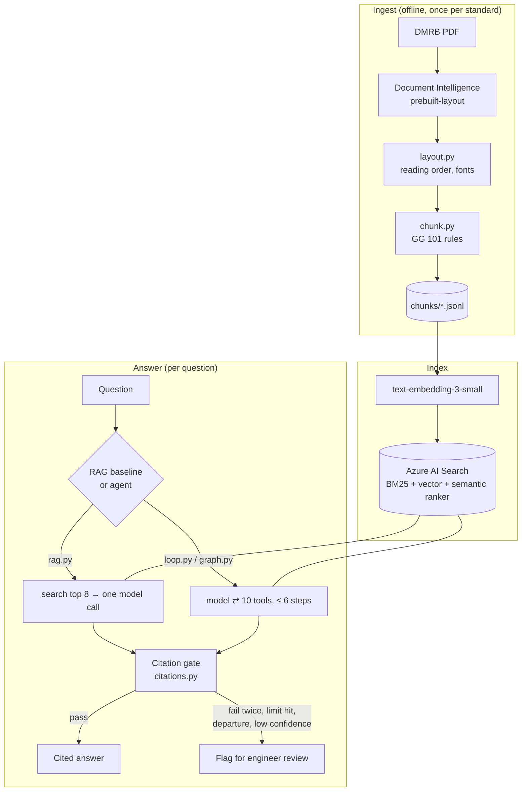

# Architecture

How the DMRB standards assistant is put together, why, and what would change in production.
Design choices are argued one at a time in [DECISIONS.md](../DECISIONS.md); this is the map.

## Components

| Layer | Module | What it does |
|---|---|---|
| Parse | `ingest/parse.py` | Document Intelligence layout model; result cached by PDF hash; the PDF's printed version is checked against `sources.yaml` before paying |
| Chunk | `ingest/layout.py`, `ingest/chunk.py` | Rebuilds reading order from line geometry, reads heading levels from fonts, applies GG 101 numbering and verbal-form rules: one chunk per clause, table, figure, glossary |
| Index | `index/` | Embeds `heading path + text`; one index, four query modes for comparison |
| Retrieve | `index/search.py`, `agent/tools/search_tool.py` | Hybrid search re-ranked semantically; a retrieved table pulls in the clauses that cite it |
| Reason | `agent/rag.py`, `agent/loop.py`, `agent/graph.py` | Structured output (`Answer`): text, citations, requirement strength, departure flag, confidence, review flag |
| Compute | `agent/tools/equations.py`, `check_limit.py` | CD 109 equations and limit checks in exact decimals; the model only supplies inputs |
| Verify | `agent/citations.py` | Parses every citation in the answer; each must be something a tool returned this run |
| Observe | `agent/trace.py` | One JSONL line per model call, tool call and check |
| Evaluate | `evals/` | recall@k / MRR on hand-written questions; hand-judged answer checks; golden set next |

## A question, end to end (agent)

1. The model gets the question, the system prompt (domain rules, Ben's) and the output contract
   (citation format, owned by code because the checker depends on it).
2. It calls `search_standards`. Azure AI Search runs BM25 and vector search, fuses them, and
   the semantic ranker re-orders the top 50. Any table in the top 8 brings up to two clauses
   whose `refs` cite it.
3. It follows references with `get_clause` / `get_table`, and calls an equation tool when a
   number is needed (e.g. superelevation for R = 510 m at 100 kph → 6.93%, Equation 4.2).
4. It answers in the `Answer` schema. Code checks every citation against the IDs the tools
   returned; a failure gets one retry with the reasons, then escalates.
5. Limits: 6 model calls, 90 s; tools are switched off on the last call so it must answer.
   Hitting a limit escalates rather than guessing.

## Controls against wrong answers

| Risk | Control | Where |
|---|---|---|
| Invented clauses | Citation gate: cited IDs must have been retrieved this run | `citations.py` |
| Arithmetic mistakes (seen live: 14% for 4.9%) | Model never calculates; equation tools and `check_limit` in `Decimal` | `equations.py` |
| Advice read as a requirement | GG 101 strength stored per chunk and shown to the model; tables bring their "shall" | `chunk.py`, `search_tool.py` |
| Out-of-scope questions | `not_covered` answers must cite nothing | `citations.py` |
| Departures from standard | `is_departure` flag forces review | `answer.py` |
| Runaway agent | Step and time limits, forced final answer | `loop.py`, `graph.py` |
| Malformed tool calls | Arguments validated by Pydantic before binding; any tool failure returned to the model as an error | `registry.py` |
| Prompt injection via document text | Retrieved text sits in `<clause>` blocks it can't close, with escaped attributes; every tool is read-only | `rag.py` |
| Leaked credentials | No keys anywhere: `DefaultAzureCredential` + RBAC | `core/clients.py` |

## Evaluation so far

- **Retrieval:** semantic recall@5 100%, MRR 0.83 on 20 engineer-written questions (keyword-only
  80%). Numbers in the README.
- **Answers:** 10 hand-judged questions per pipeline: RAG 9/10 ([rag_check](../evals/rag_check.md)),
  agent 9/10 on first run with the remaining miss escalated, not wrong
  ([agent_check](../evals/agent_check.md)).
- **Next (Phase 6):** a 30–50 question golden set with written answers; citation precision,
  departure and refusal accuracy; `azure-ai-evaluation` judges checked against a hand sample;
  a CI gate on departure accuracy.

## What changes for production

The prototype runs from a laptop on personal Azure resources. For a client deployment:

- **Hosting:** the FastAPI service (`app/api.py`, built) on Azure Container Apps, using a
  managed identity, with Azure API Management in front for auth, quotas and versioned APIs.
- **Network:** private endpoints for Search, Foundry and storage; no public access.
- **Observability:** the JSONL trace events sent to Application Insights through
  OpenTelemetry, with dashboards for escalation rate, tool errors, latency and tokens per question.
- **Safety:** Azure AI Content Safety on input and output (prompt shields); PII redaction if
  questions can contain project data.
- **Review loop (Phase 5):** escalated answers go to a queue. LangGraph's checkpointed pause
  before `review` is the mechanism. Each engineer verdict becomes a golden-set case.
- **Content updates:** re-ingest when a standard is revised. Chunks carry the version, so
  answers state it and superseded text can be filtered out.
- **Scale:** the whole DMRB is several hundred documents. Ingest runs as a batch job; the Search
  tier moves from Free to Basic/S1; charts and equations are added as tools by catalogue
  ([CHARTS.md](CHARTS.md), "Scaling to the whole DMRB").
